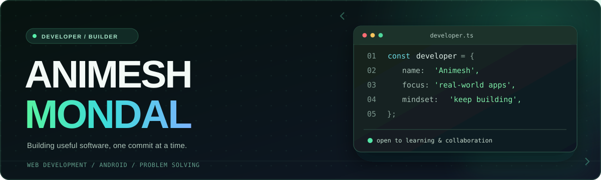
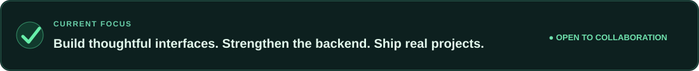
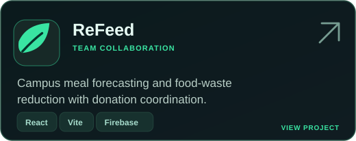
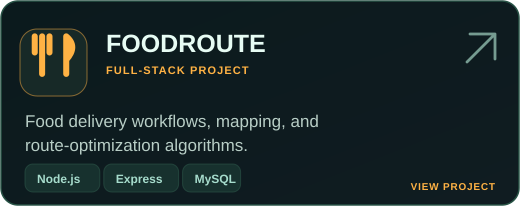
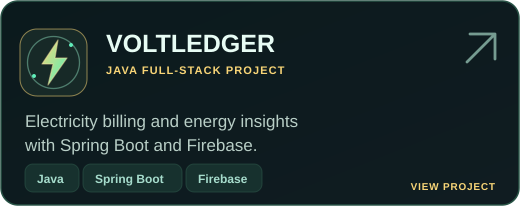
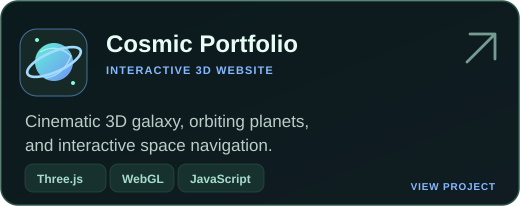
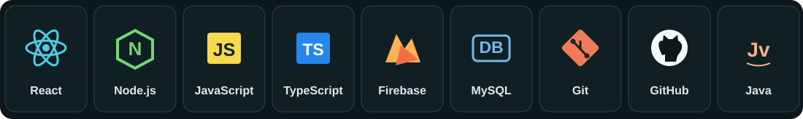
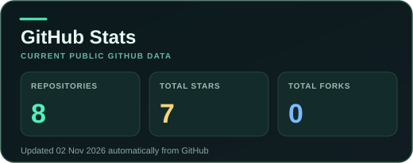
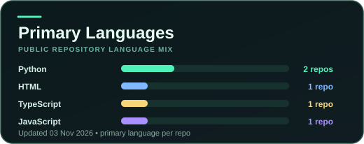

  

   

  

  

    
    
    
    
  

### ✦ About me

> **CSE student · Developer · Problem solver.** I enjoy building practical applications that bring together thoughtful frontend design, dependable backend systems, and useful algorithms.

- 🎓 Studying **Computer Science & Engineering**.
- 💻 Working with **React, JavaScript/TypeScript, Node.js, Java, Spring Boot, Firebase, and SQL databases**.
- 🌿 Collaborating on **[ReFeed](https://github.com/subhadipmondal99/ReFeed)**, a campus food-waste management project.
- 🚀 Building **[VOLTLEDGER](https://github.com/Animesh-666/VOLTLEDGER)** and an immersive **[3D Cosmic Portfolio](https://github.com/Animesh-666/Animesh-Cosmic-Portfolio)**.

### ◈ Featured projects

<table>
  <tr>
    <td width="50%"></td>
    <td width="50%"></td>
  </tr>
  <tr>
    <td width="50%"></td>
    <td width="50%"></td>
  </tr>
</table>

Click a project card to open its GitHub repository. ReFeed is a collaborative team project.

### ⚡ Tech stack & tools

  
  Technologies I use in projects or am actively learning.

### 📊 GitHub stats & activity

  
  

  

  
🎮 Bonus: Contribution Pac-Man animation

  <picture>
    <source
      media="(prefers-color-scheme: dark)"
      srcset="https://raw.githubusercontent.com/Animesh-666/Animesh-666/output-pacman/pacman-contribution-graph-dark.svg"
    />
    <source
      media="(prefers-color-scheme: light)"
      srcset="https://raw.githubusercontent.com/Animesh-666/Animesh-666/output-pacman/pacman-contribution-graph.svg"
    />
    
  </picture>

### 🤝 Connect

  
  
  
<i>“Building useful software, one commit at a time.”</i>

